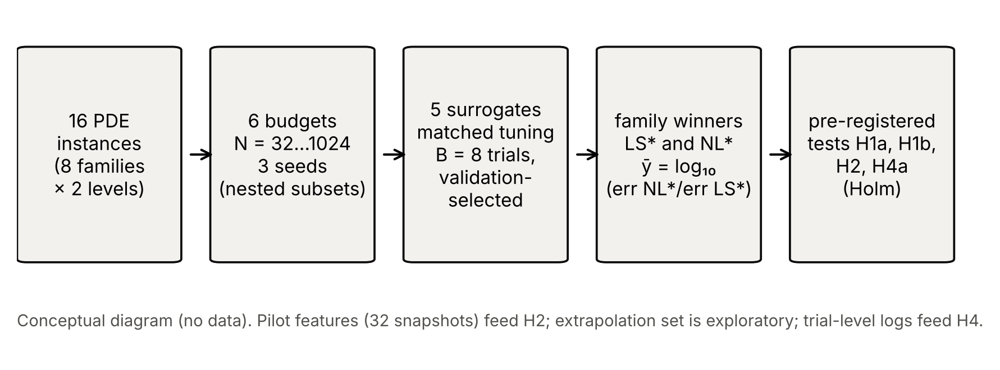

# Linear-subspace or neural? A pre-registered, matched-tuning comparison of surrogate families for parametric PDEs

**Running title:** Surrogate-family choice for parametric PDEs

**Authors:** [AUTHOR NAMES AND AFFILIATIONS — to be supplied by the authors]. **Corresponding author:** [to be supplied].

## Abstract

**Purpose.** Practitioners must choose between linear-subspace (proper orthogonal decomposition, POD, plus regression) and nonlinear-output neural surrogates for parametric partial differential equations (PDEs) before spending a simulation budget, and published comparisons are sensitive to how hard baselines are tuned. We ask how the choice depends on the training budget, whether a cheap pilot-data statistic predicts it, and how much unequal tuning effort distorts it.
**Methods.** In a pre-registered study, five surrogates (POD+Gaussian process, POD+polynomial ridge, POD+MLP, direct MLP, bottleneck MLP) received identical hyper-parameter budgets and were evaluated on 16 simulated parametric-PDE instances (8 families × 2 difficulty levels), six budgets (N = 32–1024 training solves) and three seeds, with interpolation and extrapolation test sets. Four confirmatory hypotheses were tested with Holm correction; post-hoc analyses are labelled exploratory.
**Results.** Neither family dominated. At N = 32 the nonlinear-output family won 12 of 16 instances, but by a small margin (mean 0.11 decades in error); at N = 1024 the linear-subspace family won 10 of 16, by a mean 1.35 decades (up to 3.31), whereas the neural advantage never exceeded 0.44 decades. The hypotheses that linear subspaces win at small budgets (H1a) and that neural surrogates catch up with more data (H1b) were not supported; POD+GP improved faster with data (median log–log slope -1.07 vs -0.61–-0.57 for the networks). A pre-registered test of a pilot-data diagnostic (H2) was not significant after correction (Holm-adjusted p = 0.145); exploratory analysis suggests the pilot features carry signal at N ≥ 256 (leave-one-family-out threshold accuracy 88% vs 62% majority) that needs replication. Tuning the neural family harder than the linear one raised the apparent neural win share from 47% to 56% (exact McNemar p = 0.006; Holm-adjusted 0.023), and 11% of cells changed winner between default and tuned settings.
**Conclusions.** In this suite the better family depends strongly on problem regularity: linear-subspace surrogates offer large gains where solution spectra decay fast, while neural surrogates offer modest gains elsewhere, and unequal tuning can manufacture neural wins. Findings are limited to 16 simulated instances with low-dimensional parameters, small networks and CPU training.

**Keywords:** surrogate modelling; parametric PDEs; reduced-order models; neural networks; Gaussian processes; benchmarking; pre-registration

## 1 Introduction

Surrogate models for parametric partial differential equations (PDEs) are built to replace repeated expensive simulations in design, uncertainty quantification and control. A practitioner who wishes to build one must choose a surrogate family *before* paying for the training data: a linear-subspace surrogate, in which proper orthogonal decomposition (POD) compresses the solution field and a regressor maps parameters to the reduced coefficients [Hesthaven & Ubbiali 2018; Bhattacharya et al. 2021], or a nonlinear-output network that maps parameters directly to the field, possibly through a learned latent bottleneck [Franco et al. 2023; Lee & Carlberg 2020].

Approximation theory offers a qualitative guide. When the solution manifold has a rapidly decaying Kolmogorov n-width, a small linear subspace suffices; when the decay is slow — typically for transport- or front-dominated problems — linear subspaces are inefficient and nonlinear representations are motivated [Cohen & DeVore 2015; Greif & Urban 2019; Franco et al. 2023]. This guidance is asymptotic and problem-specific. It does not tell a practitioner with a fixed budget of a few hundred simulations which family to try, and it does not say how much the answer depends on the effort spent tuning each candidate.

The second concern is empirical hygiene. A systematic review of machine-learning solvers for fluid-related PDEs found that 79% (60 of 76) of the articles that claimed to outperform a standard numerical method did so against a weak baseline, and found evidence of reporting bias [McGreivy & Hakim 2024]. Recent cost–accuracy studies compare neural surrogates with polynomial surrogates [Westermann et al. 2026], with error-matched classical solvers including end-to-end training cost [Zhang et al. 2026; Huang & Stuart 2026] and with each other [de Hoop et al. 2022; Lu et al. 2022]. To our knowledge, none of the abstracts or full-text portions we read compared neural surrogates against POD with Gaussian-process or polynomial regression under *identical* tuning budgets, or tested whether a cheap pilot-data statistic predicts which family wins on a PDE family the predictor has never seen.

**Research questions.** We ask (RQ1) how the accuracy ratio between the best nonlinear-output and the best linear-subspace surrogate changes with the number of training solves; (RQ2) whether features of a 32-snapshot pilot predict that ratio out-of-sample across unseen PDE families beyond what the budget and parameter dimension predict; (RQ3) how parameter-space extrapolation affects the two families (exploratory); and (RQ4) how much asymmetric tuning effort inflates the apparent advantage of neural surrogates.

**Contributions.** (i) A pre-registered matched-tuning comparison of five surrogate methods on 16 parametric-PDE instances at six training budgets; (ii) a leave-one-family-out test of a pilot-based diagnostic against pre-specified baselines; (iii) a paired quantification of tuning-asymmetry bias; (iv) open code and a protocol committed to version control before any comparative result was produced. We do not propose a new architecture and make no claim of state-of-the-art accuracy.

## 2 Related work

*Linear-subspace and POD-regression surrogates.* Non-intrusive reduced-order models combine POD with a regressor for the coefficients; Hesthaven and Ubbiali used neural networks for this purpose [Hesthaven & Ubbiali 2018]. PCA-Net applies the same idea in an operator-learning setting [Bhattacharya et al. 2021]. Gaussian processes are standard regressors for low-dimensional parameter spaces [Rasmussen & Williams 2006]; reduced-basis theory is surveyed in [Quarteroni et al. 2016].

*Neural operators and nonlinear manifolds.* DeepONet [Lu et al. 2021], the Fourier neural operator [Li et al. 2021] and the neural-operator framework [Kovachki et al. 2023] learn maps between function spaces; deep autoencoders learn nonlinear latent manifolds for reduced-order modelling [Lee & Carlberg 2020; Franco et al. 2023]. Our parameter-to-field setting is finite-dimensional, so we study the bottleneck and direct-output networks rather than operator-input architectures.

*Slow n-width decay.* Slow Kolmogorov n-width decay for transport and wave problems is established in the literature [Greif & Urban 2019] and is the standard motivation for nonlinear reduced models [Franco et al. 2023]; approximation rates for parametric PDEs are reviewed in [Cohen & DeVore 2015].

*Fair comparison and cost accounting.* de Hoop et al. study the cost–accuracy trade-off of neural architectures [de Hoop et al. 2022]; Lu et al. compare DeepONet and FNO [Lu et al. 2022]; Westermann et al. compare neural and polynomial operator surrogates by Pareto frontiers over hyper-parameter ensembles and report that no method is universally superior, with polynomial surrogates more data-efficient for smooth inputs and the FNO faster to converge for rough inputs [Westermann et al. 2026 (preprint)]; Zhang et al. define a breakeven complexity that includes data-generation and training cost [Zhang et al. 2026 (preprint)]; Huang and Stuart study post-training cost against classical solvers [Huang & Stuart 2026 (preprint)]. McGreivy and Hakim document weak baselines and reporting biases [McGreivy & Hakim 2024]. Grossmann et al. compare physics-informed networks with finite elements [Grossmann et al. 2024]. *Positioning:* our work does not re-claim cost accounting; it adds POD-GP/POD-polynomial baselines under matched tuning, a pre-registered out-of-sample diagnostic test, and a paired measurement of tuning asymmetry. We read only abstracts of most cited works; two preprints were read in part (about 100,000 characters each), so the absence of a pilot-based predictor in them is established only for the parts read.

## 3 Surrogate families, tuning and diagnostics

**Problem.** A parametric PDE defines a map μ ∈ ℝᵖ ↦ u(μ) ∈ ℝᵐ, where u is the full-order-model (FOM) solution sampled on an output grid (m ∈ {128, 256}). Given N training pairs {(μᵢ, u(μᵢ))}, a surrogate û is evaluated by the mean relative L₂ error err = (1/n) Σⱼ ‖û(μⱼ) − u(μⱼ)‖₂ / ‖u(μⱼ)‖₂ over n = 1000 held-out parameters.

**Linear-subspace (LS) family.** All three LS methods compute a POD basis Vᵣ from the centred training snapshots and approximate u(μ) ≈ ū + Vᵣ a(μ), differing in the regressor for a(μ): *POD+GP* (automatic-relevance-determination Gaussian processes with a Matérn-5/2 or RBF kernel; hyper-parameters optimised on up to 300 points for the leading four modes, the remaining modes reusing the fourth kernel); *POD+Poly* (ridge-regularised total-degree polynomial, degree ≤ 6, features capped at 5,000); *POD+MLP* (multilayer perceptron on the scaled coefficients).

**Nonlinear-output (NL) family.** *MLP (direct)* maps μ to the full field; *Bottleneck MLP* maps μ through a latent layer of width k ∈ {2, 4, 8, 16} to the field, trained end-to-end (a deep-ROM-style decoder without a separate encoder, because the encoder input is the parameter).

**Matched tuning.** Every method receives exactly B = 8 random-search trials, where trial 0 is the method's fixed default. Trials are scored on a random 20% validation split of the N samples; the configuration with the lowest validation error is refit on all N samples. Neural networks use Adam with cosine learning-rate decay for 1500 epochs. The test error of every trial's model is logged for the tuning analysis but never used for selection.

**Family winners and the outcome y.** For each (instance, N, seed), LS* is the LS method with the lowest validation error and NL* the NL method with the lowest validation error. The primary outcome is y = log₁₀(err_NL* / err_LS*), so that y > 0 means the linear-subspace family is better.

**Pilot diagnostics.** From the first n₀ = 32 training snapshots only, we compute f₁ = log₁₀ of the mean leave-one-out relative POD reconstruction error with r = 4 modes, and f₂, the least-squares slope of log₁₀σₖ against k for k ≤ 10 (singular values floored at 10⁻¹²σ₁). No test data and no fitted surrogate enter these quantities.

## 4 Experimental design

**Problem suite.** Eight PDE families, each at two difficulty levels, give 16 instances: steady diffusion with a random log-coefficient (Darcy-type, p = 4 and p = 10); steady advection–diffusion with upwind discretisation (diffusivity ranges 0.05–0.2 and 0.005–0.02); periodic linear transport of Gaussian pulses (wide, narrow); viscous Burgers' equation (ν ∈ [0.05, 0.1] and [0.005, 0.01], the latter shock-forming); Fisher–KPP fronts (horizon T = 0.3 and 1.2); the 2-D heat equation with a moving Gaussian source (broad, narrow); a Bratu-type nonlinear elliptic problem (λ ranges [0.2, 1.2] and [1.0, 3.5]); and the 1-D wave equation (wide, narrow pulses). Each is solved with numpy/scipy FOM codes verified by unit tests against an exact Poisson series, exact translation, d'Alembert's solution, grid-refinement convergence, Burgers self-convergence and the theoretical Fisher front speed. **All data are synthetic simulations; no real-world observations are used.**

**Data and budgets.** For each instance a pool of 4096 i.i.d. uniform training parameters, 1000 interpolation-test parameters and 500 extrapolation-test parameters (uniform on [−0.25, 1.25]ᵖ outside the unit box) were drawn from random streams seeded by the instance name. Seed s uses the first N elements of a seed-specific permutation, N ∈ {32, 64, 128, 256, 512, 1024} (nested), with seeds 0, 1 and 2.

**Pre-registration.** The hypotheses, outcomes, tests and stopping rules were written and committed to version control (commit hashes in the supplementary protocol) before any comparative experiment was run; the analysis code and its synthetic-data unit tests were committed before results existed . Items seen before registration, run restarts, one premature interim look at two of three seeds, and every post-hoc analysis are disclosed in the supplementary deviations log.

**Table 1.** The 16 problem instances (8 families × 2 levels).

| Instances         | Equation                                       | p      |   m | Difficulty levels (L1 / L2)       |
|:------------------|:-----------------------------------------------|:-------|----:|:----------------------------------|
| darcy_L1 / L2     | steady diffusion, log-coefficient field        | 4 / 10 | 256 | σ=1.0 / 2.0                       |
| advdiff_L1 / L2   | steady advection–diffusion (upwind)            | 4      | 256 | ε∈[0.05,0.2] / [0.005,0.02]       |
| transport_L1 / L2 | periodic linear transport, two Gaussian pulses | 4      | 128 | pulse width 0.08–0.12 / 0.03–0.05 |
| burgers_L1 / L2   | viscous Burgers, pseudo-spectral               | 4      | 128 | ν∈[0.05,0.1] / [0.005,0.01]       |
| fisher_L1 / L2    | Fisher–KPP front                               | 4      | 128 | horizon T=0.3 / 1.2               |
| heat2d_L1 / L2    | 2-D heat equation, moving Gaussian source      | 4      | 256 | broad, α=0.05 / narrow, α=0.005   |
| bratu_L1 / L2     | Bratu-type nonlinear elliptic (Newton)         | 3      | 256 | λ∈[0.2,1.2] / [1.0,3.5]           |
| wave_L1 / L2      | 1-D wave equation (leapfrog)                   | 4      | 128 | pulse width 0.06–0.10 / 0.02–0.04 |

{width=90%}

**Confirmatory tests** (Holm-corrected, family-wise α = 0.05): **H1a**, at N = 32 the median ȳ over the 16 instances exceeds 0 (one-sided Wilcoxon signed-rank); **H1b**, in most instances ȳ decreases with N (exact one-sided binomial test on the number of instances with negative Spearman correlation between log₂N and ȳ); **H2**, under leave-one-family-out ridge regression the model y ~ log₂N + f₁ + f₂ has a lower RMSE than y ~ log₂N + p, assessed by a family-cluster bootstrap (10,000 resamples of the 8 families); **H4a**, asymmetric tuning (NL with b = 8 trials, LS with b = 1) yields more cells in which NL "wins" than symmetric tuning (b = 8 for both; exact McNemar test). **Exploratory analyses** are labelled as such: H3 (extrapolation inflation), feature ablations, pilot-size sensitivity, learning-curve exponents and cost break-even under stylised FOM-cost multipliers.

## 5 Results

### 5.1 Overview of accuracy

Fig. 2 shows learning curves for all 16 instances and Table 3 gives median errors across instances. Errors span nearly six orders of magnitude across instances; POD+GP reaches the lowest errors on smooth problems (for example Bratu, relative error of order 10⁻⁶ at N = 1024) while on the hardest instances at N = 32 even the best method has error above 10⁻¹ (Fig. 2). POD+polynomial ridge was the weakest method overall (median error 5.02e-02 at N = 1024). Across instances the median log–log learning-curve slope (N ≥ 64) was -1.07 for POD+GP, -0.42 for POD+Poly, -0.39 for POD+MLP, -0.61 for the direct MLP and -0.57 for the bottleneck MLP.

**Table 3.** Median test error (relative L₂, interpolation set) over the 16 instances and 3 seeds.

|    N |   POD+GP |   POD+Poly |   POD+MLP |   MLP (direct) |   Bottleneck MLP |
|-----:|---------:|-----------:|----------:|---------------:|-----------------:|
|   32 |  0.109   |     0.331  |   0.0966  |        0.0941  |          0.0869  |
|   64 |  0.0482  |     0.198  |   0.0447  |        0.0375  |          0.0335  |
|  128 |  0.0241  |     0.117  |   0.022   |        0.0165  |          0.0187  |
|  256 |  0.00944 |     0.0758 |   0.0136  |        0.0111  |          0.0112  |
|  512 |  0.00409 |     0.0555 |   0.0119  |        0.00894 |          0.00907 |
| 1024 |  0.00239 |     0.0502 |   0.00677 |        0.00473 |          0.00474 |

{width=100%}

### 5.2 Confirmatory tests

**Table 2.** Pre-registered confirmatory tests (Holm correction over the four tests, family-wise α = 0.05).

| ID   | Hypothesis                            | Observed                                             | Test                       |   raw p |   Holm-adj. p | Verdict       |
|:-----|:--------------------------------------|:-----------------------------------------------------|:---------------------------|--------:|--------------:|:--------------|
| H1a  | median ȳ at N=32 > 0 (LS better)      | median ȳ = -0.059                                    | Wilcoxon (one-sided), n=16 |   0.874 |         1     | not supported |
| H1b  | ȳ decreases with N in most instances  | 5/16 instances with ρ<0                              | exact binomial (one-sided) |   0.962 |         1     | not supported |
| H2   | pilot features beat {log₂N, p} (LOFO) | Δ RMSE = 3.25, 95% CI [-0.07, 6.40]                  | family-cluster bootstrap   |   0.048 |         0.145 | not supported |
| H4a  | asymmetric tuning inflates NL wins    | 10 vs 1 discordant cells; NL-win share 46.9% → 56.2% | exact McNemar (one-sided)  |   0.006 |         0.023 | supported     |

**H1a/H1b (budget crossover).** The pre-registered expectation that linear-subspace surrogates win at small budgets was not borne out: at N = 32 the nonlinear-output family had the lower error in 12 of 16 instances (median ȳ = -0.059, Table 2). Neither did the neural family catch up with more data in most instances: only 5 of 16 instances showed a negative rank correlation between log₂N and ȳ; in the other 11 the linear-subspace advantage grew with N (Fig. 3). At N = 1024 the linear-subspace family won 10 instances and the neural family 6. The sizes of the two kinds of win are very unequal: when the linear-subspace family won at N = 1024 its mean advantage was 1.35 decades (maximum 3.31), whereas the neural family's mean advantage when it won was 0.23 decades (maximum 0.44).

{width=70%}

**H2 (pilot diagnostic).** Under leave-one-family-out evaluation the pre-specified model (log₂N + pilot CV-POD error + spectral slope) had RMSE 0.924 versus 4.172 for the pre-registered baseline B1 (log₂N + p) — Δ = 3.25, 95% cluster-bootstrap CI [-0.07, 6.40], raw p = 0.048, Holm-adjusted p = 0.145: **not supported**. The comparison is weakened by a flaw in baseline B1 that we identified after the fact: its RMSE is dominated by the held-out Darcy fold (fold RMSE 11.4), because Darcy is the only family with p = 10 and the linear p-term extrapolates badly. Against the simpler baseline B0 (log₂N only, RMSE 1.123) the improvement is smaller and also not significant (Δ = 0.20, CI [-0.20, 0.45], p = 0.165). The sign of ȳ was predicted correctly in 71% of cells by the pilot model versus 54% (B0) and 61% (B1), with a majority-class rate of 56% (descriptive). Fig. 4 shows the predictions.

{width=100%}

**H4a (tuning asymmetry).** When the nonlinear-output family received eight tuning trials and the linear-subspace family only its default configuration, the neural family "won" 56.2% of the 96 (instance, N) cells; with eight trials for both it won 46.9%. Ten cells flipped from a linear-subspace to a neural win under asymmetry and one in the opposite direction (exact McNemar p = 0.006; Holm-adjusted 0.023): **supported**. Descriptively, the winning family differed between default-only and eight-trial tuning in 11 of 96 cells (11.5%; Wilson 95% CI 6.5%–19.4%), and the Kendall τ between method rankings at b = 1 and b = 8 averaged 0.79 (minimum 0.00) (Fig. 5).

{width=45%}

### 5.3 Exploratory analyses (post hoc; none changes a confirmatory verdict)

**Table 4.** Post-hoc analyses.

| ID        | Analysis (post-hoc)                                             | Result                                                                                                               |
|:----------|:----------------------------------------------------------------|:---------------------------------------------------------------------------------------------------------------------|
| E1        | 4× longer NN training (6000 vs 1500 epochs), 12 cells, seed 0   | NN error fell in 29/36 fits (median ratio 0.70); mean shift of ȳ -0.25; sign flips 0/12                              |
| E2        | pilot size n₀ ∈ {16,…,64}                                       | M_spec vs B0: Δ RMSE 0.15–0.20; all 95% CIs include 0                                                                |
| E3        | one-feature rule (LOFO threshold on CV-POD error), N=256 / 1024 | accuracy 87.5% / 87.5% vs majority 62.5%; Spearman ρ -0.69 / -0.72; at N=64 accuracy 31.2%                           |
| E4 (= H3) | extrapolation inflation (N=256), NL* vs LS*                     | mean log₁₀ inflation 1.05 (NL*) vs 1.21 (LS*); NL* inflates more in 5/16 instances; Wilcoxon p = 0.016 (uncorrected) |
| E5        | GP-optimiser instability                                        | 4/288 POD+GP final fits >3× worse than the selected trial (2 >10×); repairing them changes no verdict                |

*Pilot features (E3).* At N ≥ 256 the pilot CV-POD error correlated with ȳ (Spearman ρ = -0.69 at N = 256) in the direction predicted by n-width theory — slower spectral decay, relatively better neural surrogate — and a one-feature leave-one-family-out threshold rule classified the winner correctly for 14 of 16 instances at N = 1024 (majority baseline 62.5%). At N = 64 the rule was no better than chance (31.2%). With 16 instances from 8 families, selected after seeing the data, this is a hypothesis for replication, not a result.

*Extrapolation (E4).* Errors on the extrapolation set were roughly one decade larger than on the interpolation set for both families; the linear-subspace winner inflated more (mean 1.21 vs 1.05 log₁₀ units).

*Training budget and optimiser robustness (E1, E5).* Quadrupling the neural training length lowered neural error in 29 of 36 refits (median ratio 0.70) and moved ȳ by -0.25 on average, but changed the winning family in none of 12 cells, so the qualitative conclusions are robust and the magnitudes are budget-sensitive. In 4 of 288 POD+GP final fits (1.4%) the refit on all N samples was more than 3× worse than the selected trial (a single-start hyper-parameter optimiser landed in a poor local optimum); repairing them leaves all verdicts unchanged (H2 raw p vs B1 0.024, still not significant after Holm correction).

*Cost.* The FOM cost was 2.9–136 ms per solve, so surrogates are cheap only relative to much costlier solvers. At N = 1024 the median final-fit and total tuning times were 6.1 s and 44 s for POD+GP versus 23.1 s and 115 s for the direct MLP (single CPU thread); POD+polynomial ridge needed 0.03 s. Break-even query counts under stylised FOM-cost multipliers are in `results/tables/cost_breakeven.csv` and are a model, not a measurement.

## 6 Discussion

**What the experiments establish.** In this suite no surrogate family was uniformly better. Linear-subspace surrogates, in particular POD+GP, were far more accurate (up to about three orders of magnitude) on instances whose solution manifolds are smooth in the parameters and spectrally compact (Bratu, Darcy L1, heat2d L1, Burgers L1, wave L1, transport L1), and their advantage grew with N. Nonlinear-output networks were better on the transport- and front-dominated, narrow-feature instances (transport L2, Fisher L2, heat2d L2, Darcy L2; also, by negligible margins, advdiff L2 and wave L2), but by margins of at most 0.44 decades. Two pre-registered expectations were wrong: linear subspaces did not win at small budgets, and neural surrogates did not catch up with data. A plausible reading (not tested here) is that, at fixed training epochs and with hyper-parameter budgets of eight trials, networks plateau at errors near 10⁻³ whereas GPs continue to converge on smooth maps; the 4× longer-training check (E1) lowered neural error by about 30% but did not reverse any winner.

**The diagnostic.** The pre-registered test of the pilot diagnostic did not pass. The exploratory association at N ≥ 256 is in the direction predicted by approximation theory (Cohen & DeVore 2015; Greif & Urban 2019; Franco et al. 2023), but our evidence is insufficient to recommend a selection rule, and at the smallest budgets, where such a rule would matter most, the pilot features were uninformative.

**Why tuning asymmetry matters.** The confirmed H4a effect is moderate (about nine percentage points of cells) but it is precisely the direction of bias described for the literature (McGreivy & Hakim 2024): giving only the proposed family a search budget turns ties into wins. Because a tenth of cells changed winner between default and tuned settings even under symmetric treatment, reports of surrogate comparisons should state the tuning budget per method.

**Relation to prior work.** Our findings are consistent in spirit with the report that no method is universally superior and that polynomial surrogates are more data-efficient for smooth inputs (Westermann et al. 2026, preprint), here extended to POD with Gaussian-process regression and with a pre-registered diagnostic test that did not succeed. We did not reproduce any cost-accounting framework (de Hoop et al. 2022; Zhang et al. 2026; Huang & Stuart 2026).

## 7 Limitations

First, sixteen instances from eight hand-chosen families are not a random sample of PDEs; conclusions concern this suite, and the confirmatory tests have limited power (8 independent families). (2) Parameters are low-dimensional (p ≤ 10) and fields are small (m ≤ 256); high-dimensional or field-valued inputs (e.g., Fourier neural operators) were not studied. (3) Neural networks were small, trained for a fixed 1500 epochs in float32 on CPU, and hyper-parameter spaces were chosen by us; larger budgets or other architectures could narrow or move the gaps (E1 shows magnitudes are budget-sensitive). (4) The POD+GP implementation uses a single-start optimiser that failed in 1.4% of final fits. (5) Intrusive POD-Galerkin was not included. (6) Seeds draw nested subsets of a finite pool, so seed-to-seed variance underestimates sampling variance at large N; only three seeds were run (the planned extension to five was not). (7) The pre-registered baseline B1 for H2 turned out to be degenerate under leave-one-family-out evaluation; the verdict is reported as registered. (8) All problems are synthetic simulations with discretisation-defined ground truth, and full-order-model costs are milliseconds, so cost statements are stylised. (9) The exploratory analyses were conceived after seeing the results.

## 8 Conclusions

For parametric PDEs with low-dimensional parameters, neither linear-subspace nor neural surrogates were uniformly superior in a matched-tuning, pre-registered comparison on 16 simulated instances. Linear-subspace surrogates with Gaussian-process regression gave very large accuracy gains where solution spectra decay fast, and their advantage grew with the number of training solves; neural surrogates gave modest gains on front- and transport-dominated instances. Unequal tuning effort measurably inflated the apparent neural advantage. A pilot-data selection rule was not confirmed; the exploratory signal at moderate budgets deserves replication on new PDE families before any practical recommendation.

## Declarations

**Funding:** [authors to complete]. **Competing interests:** [authors to complete]. **Ethics approval and consent:** not applicable (simulated data only). **Data availability:** all data are generated by the code in the project repository (`code/`); the repository is currently on the working branch `claude/happy-bell-9xorxs` of github.com/Bhargavteja-9779/rp_c_7 and has **not** been deposited in a permanent archive — authors must deposit it (e.g., Zenodo) and update this statement before submission. **Code availability:** same repository; `python run_all.py --mode full` reproduces the experiment (≈3.5 h on 4 CPU cores) and `--stage analysis` regenerates statistics, tables and figures. **Author contributions:** [authors to complete]. **AI assistance:** this study, code and draft were produced by an autonomous AI agent (Claude) working with the stated user; the human authors must verify and take responsibility for all content and confirm originality and journal-specific AI-disclosure rules. **Pre-registration:** protocol v1.0 was committed to the repository before any comparative result existed (commit hashes in the supplementary protocol); this is a version-control timestamp, not an independent registry entry.

## References

1. Bhattacharya K, Hosseini B, Kovachki NB, Stuart AM (2021) Model reduction and neural networks for parametric PDEs. SMAI J Comput Math 7:121-157. 10.5802/smai-jcm.74

2. Cohen A, DeVore R (2015) Approximation of high-dimensional parametric PDEs. Acta Numerica 24:1-159. 10.1017/s0962492915000033

3. de Hoop MV, Huang DZ, Qian E, Stuart AM (2022) The cost-accuracy trade-off in operator learning with neural networks. J Mach Learn 1(3):299-341. 10.4208/jml.220509

4. Dodge J, Gururangan S, Card D, Schwartz R, Smith NA (2019) Show your work: improved reporting of experimental results. EMNLP-IJCNLP 2019:2185-2194. 10.18653/v1/d19-1224

5. Franco NR, Manzoni A, Zunino P (2023) A deep learning approach to reduced order modelling of parameter dependent partial differential equations. Math Comp 92(340):483-524. 10.1090/mcom/3781

6. Greif C, Urban K (2019) Decay of the Kolmogorov N-width for wave problems. Appl Math Lett 96:216-222. 10.1016/j.aml.2019.05.013

7. Grossmann TG, Komorowska UJ, Latz J, Schönlieb C-B (2024) Can physics-informed neural networks beat the finite element method? IMA J Appl Math 89(1):143-174. 10.1093/imamat/hxae011

8. Hesthaven JS, Ubbiali S (2018) Non-intrusive reduced order modeling of nonlinear problems using neural networks. J Comput Phys 363:55-78. 10.1016/j.jcp.2018.02.037

9. Holm S (1979) A simple sequentially rejective multiple test procedure. Scand J Stat 6(2):65-70. JSTOR 4615733

10. Huang DZ, Stuart AM (2026) Cost-accuracy trade-offs: neural operator vs classical numerical solver. arXiv:2609.24021. arXiv:2609.24021

11. Kingma DP, Ba J (2015) Adam: a method for stochastic optimization. ICLR 2015. arXiv:1412.6980

12. Kontolati K, Goswami S, Em Karniadakis G, Shields MD (2024) Learning nonlinear operators in latent spaces for real-time predictions of complex dynamics in physical systems. Nat Commun 15:5101. 10.1038/s41467-024-49411-w

13. Kovachki N, Li Z, Liu B, Azizzadenesheli K, Bhattacharya K, Stuart A, Anandkumar A (2023) Neural operator: learning maps between function spaces with applications to PDEs. J Mach Learn Res 24(89):1-97. JMLR 24(89)

14. Krishnapriyan AS, Gholami A, Zhe S, Kirby RM, Mahoney MW (2021) Characterizing possible failure modes in physics-informed neural networks. NeurIPS 2021. arXiv:2109.01050

15. Lee K, Carlberg KT (2020) Model reduction of dynamical systems on nonlinear manifolds using deep convolutional autoencoders. J Comput Phys 404:108973. 10.1016/j.jcp.2019.108973

16. Li Z, Kovachki N, Azizzadenesheli K, et al. (2021) Fourier neural operator for parametric partial differential equations. ICLR 2021. arXiv:2010.08895

17. Lu L, Jin P, Pang G, Zhang Z, Karniadakis GE (2021) Learning nonlinear operators via DeepONet based on the universal approximation theorem of operators. Nat Mach Intell 3:218-229. 10.1038/s42256-021-00302-5

18. Lu L, Meng X, Cai S, et al. (2022) A comprehensive and fair comparison of two neural operators (with practical extensions) based on FAIR data. Comput Methods Appl Mech Eng 393:114778. 10.1016/j.cma.2022.114778

19. McGreivy N, Hakim A (2024) Weak baselines and reporting biases lead to overoptimism in machine learning for fluid-related partial differential equations. Nat Mach Intell 6(10):1256-1269. 10.1038/s42256-024-00897-5

20. Paszke A, Gross S, Massa F, et al. (2019) PyTorch: an imperative style, high-performance deep learning library. NeurIPS 32. arXiv:1912.01703

21. Pedregosa F, Varoquaux G, Gramfort A, et al. (2011) Scikit-learn: machine learning in Python. J Mach Learn Res 12:2825-2830. JMLR 12:2825-2830

22. Quarteroni A, Manzoni A, Negri F (2016) Reduced basis methods for partial differential equations: an introduction. Springer UNITEXT. 10.1007/978-3-319-15431-2

23. Rasmussen CE, Williams CKI (2006) Gaussian processes for machine learning. MIT Press. 10.7551/mitpress/3206.001.0001

24. Virtanen P, Gommers R, Oliphant TE, et al. (2020) SciPy 1.0: fundamental algorithms for scientific computing in Python. Nat Methods 17:261-272. 10.1038/s41592-019-0686-2

25. Westermann J, Huber B, O'Leary-Roseberry T (2026) Performance of neural and polynomial operator surrogates. arXiv:2604.00689. arXiv:2604.00689

26. Wilcoxon F (1945) Individual comparisons by ranking methods. Biometrics Bulletin 1(6):80-83. 10.2307/3001968

27. Zhang Y, Roberts N, Marwah T (2026) Breakeven complexity: a new perspective on neural partial differential equation solvers. arXiv:2605.15399. arXiv:2605.15399
